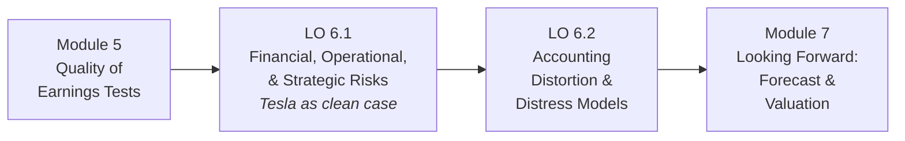

# Module 6: Risk Management and Limitations

> [!abstract] Module Purpose
> Module 5 taught you to distrust reported earnings until accrual, cash, and normalization tests pass. Module 6 widens the lens from *earnings quality* to *the whole firm*: which **real risks** — financial, operational, strategic — endanger the enterprise (LO 6.1), and how **accounting choices and reporting limits** can mask, delay, or distort exactly those risks (LO 6.2). The two objectives form one connected arc: a risk is only as visible as its reporting lets it be — hidden lease obligations, footnote contingencies, historical-cost balance sheets, and pro-forma earnings can each move a real risk *off* the instruments a credit analyst relies on.
>
> The running example stays **Tesla, Inc.** (FY2025 Form 10-K) — a deliberately low-financial-risk calibration case, with textbook distress cases (Fridson & Alvarez) supplying the danger shapes Tesla's numbers do not show.

  
THE TWO-STAGE RISK ARC

  

    

    
&#9660;

    

  

  

    
<b>6.1 &middot; Risk diagnosis</b> What real economic threats endanger the firm? liquidity &middot; leverage &middot; coverage &middot; CCC &middot; operating leverage &middot; strategic shocks

    
&rarr;

    
<b>6.2 &middot; Distortion recognition</b> How can accounting mask those threats? off-balance-sheet items &middot; lease/pension/contingencies &middot; historical-cost limits &middot; audit opinions &middot; pro-forma &middot; Altman Z &amp; KMV

  

## Learning Objectives

| Objective | Full Title | Analytical Focus |
|---|---|---|
| [[M6-Obj-6-1]] | Identify Financial, Operational, and Strategic Risks | Liquidity ratios &amp; the liquidity paradox · capital structure &amp; the equity cushion · coverage ratios &amp; Beaver's debt-to-CFO payback · covenant tripwires &amp; technical default · cash conversion cycle (DSI/DSO/DPO) · operating leverage · macro/cyclical, seasonal, and reputational-ESG shocks |
| [[M6-Obj-6-2]] | Recognize Potential Accounting Distortion | Operating-lease capitalization (8× rule) · unfunded pension/OPEB &amp; PBGC priority · contingent liabilities &amp; guarantees · historical cost vs. liquidation reality · audit-opinion hierarchy &amp; going-concern warnings · pro forma mirages &amp; serial restructuring · Beaver univariate trend · Altman Z-score decision zones · KMV distance-to-default |

> [!success] Key Findings from the Tesla Application
> - **Financial risk ≈ nil**: cash plus short-term investments of **\$44,059M** exceed total debt and finance-lease obligations of **\$8,376M** (only \$1,640M due within a year) — a fortress balance sheet that funds 2026 CapEx internally ([[M2-Obj-2-1]], [[M2-Obj-2-3]])
> - **Coverage is falling, not failing**: EBIT interest coverage eased from **57.0×** (FY2023) to **12.9×** (FY2025) as margins compressed — nowhere near covenant territory, but the *direction* matters; Beaver's debt-to-CFO payback stands at **0.57 years**
> - **The real risk is operational leverage and supplier financing**: FY2025 revenue fell **2.9%** while operating income fell **38.5%** (margin 9.2% → 4.6%); the cash conversion cycle is a fast **+13.9 days** only because DPO stands at 60.7 days — and payables growth of **≈\$4.4B** is propping CFO ([[M2-Obj-2-3]])
> - **The strategic risks concentrate where accounting has latitude**: regulatory credits (**\$1,993M ≈ 46% of operating income**, phased out by law) and resale-value guarantees (**\$1.45B → \$3.45B** exposure) set up exactly the mask-risks LO 6.2 interrogates

## The Module 6 Analytical Framework

| Step | Technique | Question Answered | Where Applied |
|---|---|---|---|
| 1 | Liquidity battery (current · quick · cash-flow liquidity) | Can the firm meet obligations coming due? | [[M6-Obj-6-1]] §I |
| 2 | Capital-structure ratios (debt-to-capital · debt-to-equity) | How thick is the equity cushion beneath creditors? | [[M6-Obj-6-1]] §I |
| 3 | Coverage &amp; payback (EBIT/cash interest coverage · Beaver debt-to-CFO) + covenant tripwires | Can cash actually service the debt — and what happens on breach? | [[M6-Obj-6-1]] §I |
| 4 | Cash conversion cycle (DSI + DSO − DPO) | How fast does an operating dollar circulate? | [[M6-Obj-6-1]] §II |
| 5 | Operating-leverage &amp; cost-structure stress test | What does a downturn do to a fixed-heavy firm? | [[M6-Obj-6-1]] §II |
| 6 | Strategic / climatic / reputational screening | Which risks do ratios systematically miss? | [[M6-Obj-6-1]] §III |
| 7 | Lease, pension, and contingency adjustments | What obligations never reached the debt lines? | [[M6-Obj-6-2]] §I |
| 8 | Reporting-limit checks (historical cost · audit opinions · pro forma) | Which reporting boundaries distort the picture? | [[M6-Obj-6-2]] §II |
| 9 | Distress models (Beaver trend · Altman Z · KMV) | Can the risk be scored before the default? | [[M6-Obj-6-2]] §III |

> [!tip] From Skepticism Back to the Whole Firm
> Modules 2–5 built increasingly powerful tests of *one earnings number at a time*. Module 6 zooms out: the same toolkit — ratios, cash flow, and the discipline to read the notes — now serves **credit and solvency judgment**. And the module ends where skeptical analysis begins: financing a firm whose numbers may flatter it. The distortions M6 catalogs ([[M6-Obj-6-2]]) are the reason Module 7's forecasts must build on the *adjusted*, not the reported, statements.

---
## Prerequisites

- Tesla FY2025 Form 10-K (filed Jan 2026) — balance sheet, debt schedule, lease footnote, guarantee disclosures, FY2023–25
- Fluency with the M2 balance-sheet mechanics and M3 ratio machinery ([[M2-Overview]], [[M3-Overview]])
- The Module 5 earnings-quality vocabulary ([[M5-Overview]]) — several LO 6.2 distortions are the same abuses M5 exposed, now read for credit instead of earnings
---
## Book References

> [!info] Sources
> - The risk-analysis chapters of *Financial Statement Analysis: A Practitioner's Guide* (3rd Ed) by Martin Fridson and Fernando Alvarez — credit-arithmetic, debt capacity, and off-balance-sheet financing
> - **Chapter 9** ("Reliability of Disclosure") and **Chapter 13** ("Default Risk Models") anchor LO 6.2's reporting-boundary and distress-model content; Ch. 13 supplies the Beaver model, the Altman Z-score, and the option-based (KMV) approach used in §III of [[M6-Obj-6-2]]
> - Classic distress and off-balance-sheet cases (W.T. Grant, Sage Inc., Apex Retail, Dow Corning, Enron) are drawn from the same text

---
## Related Notes

- [[M5-Overview]] — the earnings-quality layer this module builds on
- [[M5-Obj-5-3]] — same distortions (contingencies, pro forma, nonrecurring charges) read for earnings instead of credit
- [[M2-Obj-2-1]] — the classified balance sheet and its hidden-hazard vocabulary
- [[M2-Obj-2-3]] — cash-flow statement and the supplier-financing warning reused in LO 6.1
- [[Course-Overview]] — full program map
- Next: [[M7-Overview]]
